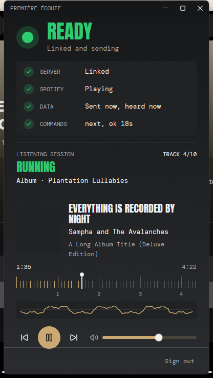
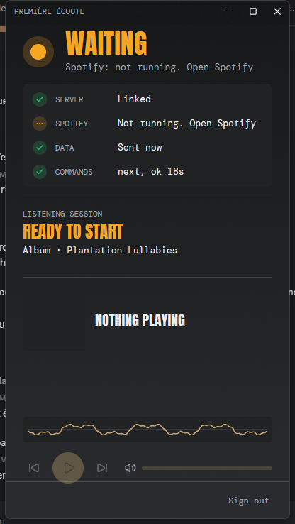
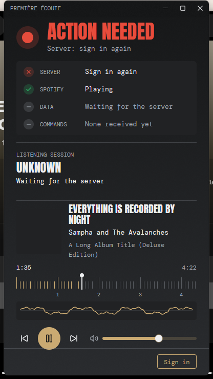
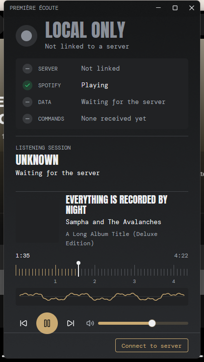

# UI design









The window is a companion to a listening session, not a player. It sits next to a stream, and its job is to make the streamer **confident about the link**: one glance says whether the session will work, and if not, what to fix. The music controls are still there, small, because they are handy, but they are not the point.

## Layout

A compact card of a fixed size (400 by 730, not resizable): every block has a fixed height, so a bigger window would only add empty space. From top to bottom:

1. **The verdict**: a beacon and a headline in the status light's colour (`READY`, `WAITING`, `ACTION NEEDED`, `LOCAL ONLY`), with one line naming the first thing to fix (`Spotify: not running. Open Spotify`).
2. **The checklist** (the signals): four rows, one per thing that has to be true, each with a glyph (tick, dots, cross, dash), what is checked and what is true now.
3. **The listening session**: its own section between two separators, see below.
4. **Now playing**: the cover, the title in the poster face (up to two lines), the artist, and the album in full (up to two lines, so a long album name is readable).
5. **The minute ruler** with the elapsed and total time, and **the live waveform**.
6. **Transport and volume** on one row.
7. **The footer**, one fixed row: the actions the link needs (Cancel while waiting for the browser, Sign in, Sign out, Connect to server, and Change server, which stops the link, forgets the saved address and opens the address field again; the credential of the old server is kept). While the server address is edited, the field, Connect and a close button take the row's place, and an invalid address is shown in the verdict's hint line, so the window never changes height.

## The checklist

| Row | Ok | Waiting | Bad | Off |
|---|---|---|---|---|
| Server | `Linked` | `Connecting`, `Waiting for the browser` | `Offline, retry in 12 s`, `Sign in again`, `Error: …` | `Not linked` |
| Spotify | `Playing`, `Paused`, `Stopped` | `Not running. Open Spotify` | `Can't read it: …` | |
| Data | `Sent 3s`: a snapshot left lately | `Waiting for the first send` | `Nothing sent for 8s` | `Waiting for the server` |
| Commands | `next, ok 18s`: the last command and how it ended | | `next, failed 4s` | `None received yet` |

`Data` is the proof that information flows: the backend gives up on a player that stays silent for 5 s and goes back to polling Spotify, so more than 5 s without a snapshot is Bad, and the light cannot be green. `Commands` is information only: it never decides the verdict, so one refused command does not turn a working link red.

The rules live in `src/status.rs` (pure and tested). A test checks the light is green exactly when `Server`, `Spotify` and `Data` are all Ok, for every combination, so the window and the taskbar badge cannot disagree.

A planned row, "the server heard us" (an acknowledgement of snapshots), would go after `Data`. The window draws whatever rows it is given.

## The listening session

A section of its own between the signals and the player, closed by separators (no card, no coloured edge), because it answers a different question: not "does the link work" but "where is the streamer". It shows what the server last reported through the `session` event (no votes): a small label with the track position on the right, the state in the poster face, and what it is about on its own line, in full text colour, wrapping to two lines rather than being cut.

| Headline | Colour | Means | Line below |
|---|---|---|---|
| `RUNNING` | green | A session is running | `Album · Plantation Lullabies`, and `TRACK 4/10` on the right for an album or a playlist |
| `READY TO START` | amber | Prepared in the last two hours, not started | Same, without a position |
| `NO SESSION` | grey | The streamer has none | `Start one from the dashboard` |
| `UNKNOWN` | grey | The server has not answered yet, or the link is not live | `Waiting for the server` |

It is information only: it never decides the verdict (a working link with no session is still `READY`), and it is forgotten as soon as the link is not live, so an old answer is never shown as current. The rules are `session_view` in `src/status.rs`.

## Status colours

The light and the checklist use fixed green, amber, red and grey (`Light::rgb`), never the cover's palette: a green cover must not look like a green light. The same colours are on the taskbar badge and the tray icon (see below). Problems that are not link problems (a failed local command) use the palette's warning colour.

| Light | Meaning |
|---|---|
| Green | Linked to the server, sending, and Spotify is running |
| Amber | Signing in, connecting, retrying, nothing sent lately, or Spotify is not running |
| Red | Login rejected, server error, or the player cannot read Spotify |
| Grey | Local only |

Playing or paused does not change it. Minimizing the window hides it to the tray (no taskbar button); the tray icon is pinned to the visible tray at the first run, a left click restores the window and a right click offers Open and Quit. Nothing flashes.

## Palette comes from the cover

Every album gives the window a different look. `artwork.rs` takes the cover's dominant hue (a weighted hue histogram of a 32x32 thumbnail, ignoring dark and grey pixels), plus a second hue: the strongest bin at least 60 degrees away with at least 20% of the first's weight. `ui/palette.rs` turns that tint into seven colours:

| Role | Use |
|---|---|
| `bg`, `bg_end` | the window's top-to-bottom gradient: the cover's dominant hue to its second hue (a hue 50 degrees on when the cover has one colour), both very dark |
| `surface` | cover placeholder, very dark and slightly tinted |
| `ink`, `muted` | text, secondary text |
| `accent` | the play button, lit ruler ticks, links that are alive |
| `on_accent` | glyph on the accent |
| `warn` | problems; a fixed hue so it never blends into a cover |

Contrast is enforced by tests for every hue (text 12:1 on the background, accent and muted text at least 4.5:1, glyph on accent at least 4.5:1). A grey cover or no cover falls back to a neutral slate with a sodium amber accent.

## Type

- **Anton** (poster face, condensed) for the track title only, uppercase, at most two lines.
- **DM Mono** for everything else: credits, times, labels, the footer.

Both are SIL OFL fonts embedded from `assets/fonts/` (licences next to them). The monospace face gives times and counters stable widths.

## Signature: the minute ruler

The progress bar is a ruler. A tick per 5 s (wider steps on long tracks, never more than about 90 ticks), a long tick per minute, and the minute number under it. Played ticks light up in the accent; a needle marks the position. The spacing is real time, so the ruler shows the track's length at a glance. `ui/ruler.rs` computes the ticks.

## Live waveform

Under the ruler, a small box with a line that stays in place and moves with the sound, like an oscilloscope: Spotify's actual waveform of the last ~25 ms, redrawn about 30 times a second over a faint baseline. The track itself is unknown, so this is what plays now. Flat when paused. Spotify's audio only; see `docs/architecture.md`.

## Copy

Sentence case, plain verbs, no apologies, no separator characters between pieces of a phrase (use separate lines, elements or commas). Empty states say what to do ("Open Spotify on this PC. It shows up here as soon as it plays."). Command failures say what failed ("Last action failed: …").

## Looking at the UI without a backend or Spotify

The window reads `PLAYER_UI_PREVIEW` (comma separated) at startup, for development only:

- `connected`, `connecting`, `offline`, `unauthorized`, `failed`: fake backend states with a believable exchange. A previewed `connected` keeps sending, so it stays green.
- `no-session`, `preparing`: with `connected`, what the server says about the listening session (the default is a running album session on its fourth track).
- `connect`: start with the server address field open.
- `idle`: do not talk to Spotify; show the "Nothing playing" state.
- `sample`: do not talk to Spotify; show a playing track with long names, to check truncation and spacing (with a synthetic signal in the waveform).

`tools/shot.sh <exe> <out.png> [wait-seconds] [preview]` launches a built exe (a WSL path, copied to your Windows profile directory first) on Windows through WSL, captures its window and closes it. Example:

```
tools/shot.sh target/x86_64-pc-windows-msvc/release/premiere-ecoute-player.exe /tmp/shot.png 6 connected
```

## Not done

- Seeking (clicking the ruler). The backend call (`TryChangePlaybackPositionAsync`) exists in SMTC; the ruler is display-only.
- Removing the tray icon if the process is killed (Windows drops the ghost on the next hover). The icon is added again when Explorer restarts (`TaskbarCreated`); that path is tested for its decisions and smoke-tested, not against a real Explorer restart.
- Light theme. The palette is always dark by design.
- Keyboard shortcuts and visible focus rings for the custom transport controls.
