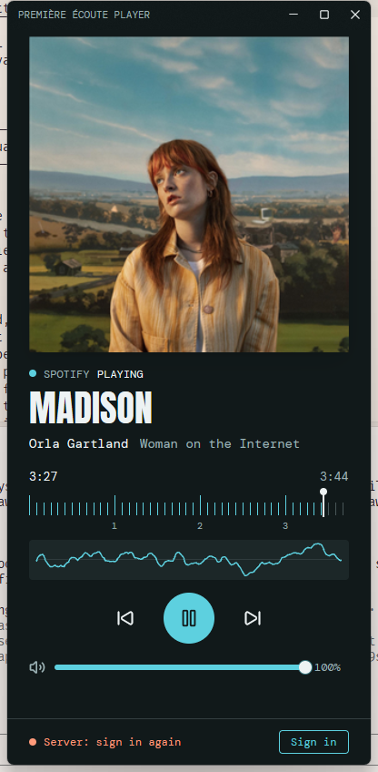
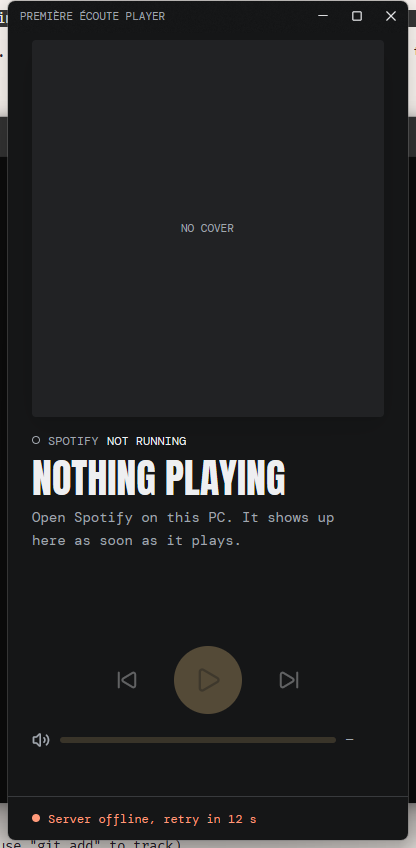
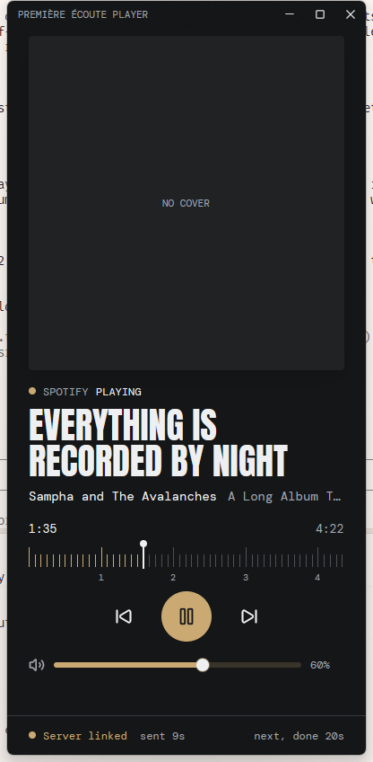

# UI design







The window is a remote for one thing: the Spotify on this PC. It sits next to a stream, so it has to read at a glance (what is playing, is it playing) and be hard to misclick.

## Layout

A vertical card (default 400 by 840, minimum 360 by 660). From top to bottom: the cover, the Spotify state, the title and one credits line (the artist, then the album in the muted colour; the album is left out when it only repeats the title, as for singles, and long names are truncated), the minute ruler with the elapsed and total time, the live waveform, the transport buttons centred, the volume row, a line for failed commands, and the server band. The cover takes whatever height the controls leave, so a shorter window crops it instead of clipping the controls.

## Palette comes from the cover

Every album gives the window a different look. `artwork.rs` takes the cover's dominant hue (a weighted hue histogram of a 32x32 thumbnail, ignoring dark and grey pixels). `ui/palette.rs` turns that tint into six colours:

| Role | Use |
|---|---|
| `bg`, `surface` | window and cover placeholder, very dark and slightly tinted |
| `ink`, `muted` | text, secondary text |
| `accent` | the play button, lit ruler ticks, links that are alive |
| `on_accent` | glyph on the accent |
| `warn` | problems; a fixed hue so it never blends into a cover |

Contrast is enforced by tests for every hue (text 12:1 on the background, accent and muted text at least 4.5:1, glyph on accent at least 4.5:1). A grey cover or no cover falls back to a neutral slate with a sodium amber accent.

## Type

- **Anton** (poster face, condensed) for the track title only, uppercase, at most two lines.
- **DM Mono** for everything else: credits, times, labels, the footer.

Both are SIL OFL fonts embedded from `assets/fonts/` (licences next to them). The monospace face gives times and counters stable widths.

## Signature: the minute ruler

The progress bar is a ruler. A tick per 5 s (wider steps on long tracks, never more than about 90 ticks), a long tick per minute, and the minute number under it. Played ticks light up in the accent; a needle marks the position. The spacing is real time, so the ruler shows the track's length at a glance. `ui/ruler.rs` computes the ticks.

## Live waveform

Under the ruler, a small box with a line that stays in place and moves with the sound, like an oscilloscope: Spotify's actual waveform of the last ~25 ms, redrawn about 30 times a second over a faint baseline. The track itself is unknown, so this is what plays now. Flat when paused. Spotify's audio only; see `docs/architecture.md`.

## Footer: link to the backend

One short row. On the left, a dot and the link: `Local only` (no server address yet, with a "Connect to server" button that opens an address field, prefilled with `http://localhost:4000`; Enter or Connect saves it and starts the link), `Connecting to server`, `Server linked`, `Server offline, retry in 12 s`, `Server: sign in again`, `Server error: …`. When linked, the row also shows `sent 7s` (age of the last snapshot sent) and, right-aligned, the last command received with its outcome (`next, ok 18s`), which appears only once a command has been received. "Sign out" sits at the right end of the row once the player is enrolled (not in the title bar: Windows treats the whole title bar as the window caption, so clicks inside it never reach a button). Problems use the warning colour. The source of truth is `RemoteStatus` in `src/remote_status.rs`; only the remote subsystem (ADR 0001) writes it.

## Copy

Sentence case, plain verbs, no apologies, no separator characters between pieces of a phrase (use separate lines, elements or commas). Empty states say what to do ("Open Spotify on this PC. It shows up here as soon as it plays."). Command failures say what failed ("Last action failed: …").

## Looking at the UI without a backend or Spotify

The window reads `PLAYER_UI_PREVIEW` (comma separated) at startup, for development only:

- `connected`, `connecting`, `offline`, `unauthorized`, `failed`: fake backend states with a believable exchange.
- `connect`: start with the server address field open.
- `idle`: do not talk to Spotify; show the "Nothing playing" state.
- `sample`: do not talk to Spotify; show a playing track with long names, to check truncation and spacing (with a synthetic signal in the waveform).

`tools/shot.sh <exe> <out.png> [wait-seconds] [preview]` launches a built exe on Windows through WSL, captures its window and closes it. Example:

```
tools/shot.sh 'C:\Users\lanfe\ui-shot.exe' /tmp/shot.png 6 connected
```

## Not done

- Seeking (clicking the ruler). The backend call (`TryChangePlaybackPositionAsync`) exists in SMTC; the ruler is display-only.
- Light theme. The palette is always dark by design.
- Keyboard shortcuts and visible focus rings for the custom transport controls.
- Cancel while waiting for the browser, and changing the saved server from the window (see `docs/refactoring.md`, A3 and A4).
